# Lara · Guía de UI para `lara-web`

Referencia visual y de diseño para construir Lara (carpeta `apps/lara-web`, React + Vite + Tailwind).
Las capturas están en `png/`. Si una captura y este texto no coinciden, **manda la captura**.

> Todos los datos de las pantallas son de ejemplo. Nada de esto es información real.

**Exact values:** para spacing, tamaños y estructura exactos, consulta `html/src/<NN>-<pantalla>.html` (mismo número y nombre que el PNG) y `html/src/_shell.css` (CSS compartido del shell); los PNG muestran el aspecto. Cada archivo es la fuente legible de una pantalla: barra lateral más la vista, en HTML y CSS planos; `12-finanzas.html` y `14-finanzas-tarjetas.html` incluyen todas las tabs, con las no activas en `hidden`. `html/lara-canvas.html` es el canvas original con todas las pantallas, pero va empaquetado (gzip + base64) y no se puede leer directamente. Si discrepan, el PNG manda para el aspecto y el HTML para las medidas.

## Cómo usar esta guía con Copilot

- No la cargues completa en cada conversación. Pásale solo lo que necesita la tarea:
  `#docs/design/lara/README.md` + la captura de la pantalla que vas a construir.
- Construye **una pantalla por tarea**, en el orden de la tabla de pantallas.
- Los colores y medidas de la sección "Tokens" van en `tailwind` / CSS variables una sola vez; las pantallas solo los usan.

## Tokens

### Colores

| Escala/token       | Hex       | Uso                                      |
| ------------------ | --------- | ---------------------------------------- |
| `neutral-50`       | `#FAFAFA` | Texto/superficies sobre accent (claro)   |
| `neutral-100`      | `#F5F5F5` | Neutro claro                             |
| `neutral-200`      | `#E6E6E6` | Neutro claro                             |
| `neutral-300`      | `#D6D6D6` | Estado danger                            |
| `neutral-400`      | `#A5A5A5` | Estado warn                              |
| `neutral-500`–`700`| `#767676`–`#434343` | Neutros medios (sin uso semántico directo) |
| `neutral-900`      | `#131416` | Estado danger (claro)                    |
| `neutral-950`      | `#0A0C0E` | Texto principal (claro)                  |

Desde la vuelta de colores, **claro y oscuro ya no son la misma paleta invertida**: son dos familias de color distintas, cada una con su propio primitivo en `index.css`.

**Claro** — azules (fondo e interacción) + blanco (superficies):

| Token               | Hex       | Uso                                          |
| ------------------- | --------- | --------------------------------------------- |
| `azul-claro`         | `#E9F1FA` | Fondo de la app                               |
| `azul-claro-hover`   | `#D3E6F5` | Hover/activo, muted sobre highlight           |
| `azul-claro-borde`   | `#C7DCEC` | Bordes y divisores                            |
| `azul-claro-borde-fuerte` | `#9FBFD9` | Bordes marcados                       |
| `azul-brillante`     | `#00ABE4` | Solo fondo (con tinta oscura) o `chart-5` (decorativo, siempre con etiqueta); como texto da 2.64:1, no alcanza 4.5:1 |
| `azul-oscuro`        | `#006786` | Texto: accent, muted, faint, ok, highlight     |
| `azul-hover`         | `#007A9E` | Fondo de accent-hover (con tinta blanca)       |
| `azul-chart-2/4/5`   | `#0086B0` / `#004F66` / `#003347` | Serie de gráficas |

**Oscuro** — negro carbón + grises, provisional mientras se decide un color definitivo (sustituyó a cian/rosa/lavanda):

| Token                   | Hex       | Uso                                       |
| ----------------------- | --------- | ------------------------------------------ |
| `mono-bg`                | `#121212` | Fondo, barra lateral y superficies         |
| `mono-hover`             | `#1E1E1E` | Hover/activo                               |
| `mono-borde`             | `#444444` | Bordes y divisores                         |
| `mono-borde-fuerte`      | `#5A5A5A` | Bordes marcados                            |
| `mono-texto`             | `#E0E0E0` | Texto principal                            |
| `mono-texto-2`           | `#B0B0B0` | Texto secundario                           |
| `mono-acento`            | `#888888` | Accent, muted, faint, ok, highlight, botón/CTA |
| `mono-acento-hover`      | `#A0A0A0` | Fondo de accent-hover (con tinta negra)    |
| `mono-ink`               | `#121212` | Texto sobre accent/highlight                |
| `mono-muted-sobre-acento`| `#1A1A1A` | Texto muted sobre highlight                 |
| `mono-chart-1/2/4/5`     | `#D0D0D0` / `#B0B0B0` / `#707070` / `#505050` | Serie de gráficas |

#### Series de gráficas

| Token      | Claro     | Oscuro    |
| ---------- | --------- | --------- |
| `chart-1`  | `#003347` | `#D0D0D0` |
| `chart-2`  | `#004F66` | `#B0B0B0` |
| `chart-3`  | `#006786` | `#888888` |
| `chart-4`  | `#0086B0` | `#707070` |
| `chart-5`  | `#00ABE4` | `#505050` |

#### Estados

| Token      | Hex (claro / oscuro)   | Uso                                      |
| ---------- | ------------------------ | ----------------------------------------- |
| `ok`       | `#006786` / `#888888`    | Correcto, arriba, permitido              |
| `warn`     | `#575757` / `#A5A5A5`    | Pendiente, parcial, solo lectura         |
| `danger`   | `#131416` / `#D6D6D6`    | Error, bloqueado, rechazado              |

**Regla:** el estado nunca se comunica solo con color. Siempre va con texto ("Arriba", "Pendiente", "bloqueada") y, en los puntos de estado, con forma: círculo lleno (ok), rombo (warn) y anillo hueco (danger). `ok`/`warn`/`danger` se quedaron en gris/azul-oscuro a propósito (no rojo/verde): es una decisión de accesibilidad a daltonismo, no se tocó con el cambio de paleta.

#### Tema claro / oscuro

En `index.css` cada token semántico se define una sola vez con `light-dark(claro, oscuro)`. `:root` declara `color-scheme: light dark` (sigue `prefers-color-scheme`) y `data-theme="claro" | "oscuro"` en `<html>` lo fuerza; la preferencia (`sistema` | `claro` | `oscuro`) se guarda en `lara.tema` y se aplica antes del primer render. `light-dark()` funciona desde Chrome y Edge 123, Firefox 120 y Safari 17.5.

| Token | Claro | Oscuro |
| ----- | ----- | ------ |
| `bg` | #E9F1FA | #121212 |
| `sidebar` | #FAFAFA | #121212 |
| `surface` | #FAFAFA | #121212 |
| `surface-hover` | #D3E6F5 | #1E1E1E |
| `surface-active` | #D3E6F5 | #1E1E1E |
| `border` | #C7DCEC | #444444 |
| `divider` | #C7DCEC | #444444 |
| `border-strong` | #9FBFD9 | #5A5A5A |
| `border-control` | #6B6B6B | #888888 |
| `control-off` | #6B6B6B | #888888 |
| `text` | #0A0C0E | #E0E0E0 |
| `text-2` | #2B3A44 | #B0B0B0 |
| `muted` | #006786 | #888888 |
| `faint` | #006786 | #888888 |
| `accent` | #006786 | #888888 |
| `accent-hover` | #007A9E | #A0A0A0 |
| `accent-ink` | #FAFAFA | #121212 |
| `highlight` | #006786 | #888888 |
| `highlight-ink` | #FAFAFA | #121212 |
| `highlight-muted` | #D3E6F5 | #1A1A1A |
| `ok` | #006786 | #888888 |
| `warn` | #575757 | #A5A5A5 |
| `danger` | #131416 | #D6D6D6 |

**Nota de contraste:** `border-control`/`control-off` pasaron de un solo valor en ambos temas a `light-dark()` — el fondo gris pizarra oscuro necesitaba un gris más claro que el claro para llegar a 3:1 contra ambos. `azul-brillante` (`#00ABE4`, el color pedido tal cual) solo se usa de fondo (con tinta oscura) o en `chart-5` (decorativo, siempre con etiqueta); como texto da 2.64:1, no alcanza 4.5:1 — en cualquier rol de texto se usa `azul-oscuro` (mismo matiz, oscurecido).

Contraste calculado desde estos tokens y verificado en `src/contraste.test.ts`: texto >= 4.5:1 y controles y estados >= 3:1 en ambos temas. La única excepción es `chart-5`, que siempre va con etiqueta y valor en texto. `ok` y `danger` se distinguen además por forma y por texto.

### Tipografía

- Fuente de la interfaz: **IBM Plex Sans** (por defecto, la que muestran los PNG) o **IBM Plex Mono**, a elegir en el diálogo "Apariencia". Se aplica con el atributo `data-font` (`ibm-plex-sans` | `ibm-plex-mono`) en `<html>`, que cambia `--font-sans`, y se guarda en `localStorage` con la clave `lara.fuente`. Lato y NTR, que esta guía listaba antes, no están instaladas: se añadirían solo si se decide y se autoriza el paquete.
- Datos técnicos (••••, puertos, ids, tokens, SQL, nombres de tools): siempre **IBM Plex Mono** vía `--font-mono`, con cualquiera de las fuentes elegidas.
- Fechas, montos y porcentajes: fuente de la interfaz con cifras tabulares (`font-variant-numeric: tabular-nums`, utilidad `num`). No usan mono.
- Las fuentes se sirven desde el repo con Fontsource; no se carga Google Fonts en ejecución.
- Tamaños: título de pantalla 26px/600 · subtítulo 14px muted · cuerpo del chat 15px/1.6 · tablas 13px · etiquetas de sección 11px mono con `letter-spacing: .08em`.

#### Escala tipográfica y cortes (tokens de `index.css`)

| Token / utilidad              | Valor     | Uso                                         |
| ----------------------------- | --------- | ------------------------------------------- |
| `text-label`                  | 11px      | Etiquetas de sección en mono, `.08em`        |
| `text-compact`                | 13px      | Tablas, notas, mensajes de estado            |
| `text-body`                   | 15px/1.6  | Cuerpo del chat y controles de texto         |
| `text-heading`                | 17px      | Título de tarjeta                            |
| `text-brand` · `text-stat`    | 19px · 22px | Marca en la barra lateral · cifra destacada |
| `text-title` · `text-hero`    | 26px · 34px | Título de pantalla · saludo del chat        |
| `text-display`                | 44px      | Titular del login                            |
| `shell:` · `wide:`            | 980px · 1180px | Barra lateral fija · cuadrículas anchas |

Los componentes no usan valores arbitrarios (`text-[13px]`, `rounded-[10px]`…) ni las escalas crudas `neutral-*` / `hoki-*`: solo tokens semánticos (lo verifica `src/tokens.test.ts`).

### Medidas

- Radios: botones 8–10px · tarjetas 12–14px · composer 16px · pills 999px.
- Espaciado: padding de pantalla 32px · gap entre bloques 24px · gap en grids 16px.
- Barra lateral: 272px fija. Contenido del chat: `max-width: 760px` centrado.
- Área táctil mínima 44px en la navegación. En menos de 980px la barra lateral se oculta y los grids pasan a una columna.
- Las barras de desplazamiento están ocultas en todas las áreas con scroll (`scrollbar-width: none` y `::-webkit-scrollbar { display: none }`); el desplazamiento sigue funcionando.

## Estructura de la app

```
App
├── Sidebar
│   ├── Logo + contraer
│   ├── Nuevo chat (botón principal) · Estado del lab
│   ├── LABORATORIO (colapsable): Agentes · Base de datos · Memoria vectorizada · Herramientas MCP · Menú por rol · Usuarios y roles
│   ├── PERSONAL · SOLO LOCAL: Finanzas · Gastos fijos
│   ├── RECIENTES: lista de chats
│   └── Usuario (username, rol, entorno) · Configuración · Cerrar sesión
└── Main: una vista a la vez (ruta por vista)
```

El item activo usa `aria-current="page"`. Cerrar sesión llama a `logout` de Keycloak.

## Pantallas

| #   | Captura                         | Vista               | Parte del lab      | Fuente de datos                                       |
| --- | ------------------------------- | ------------------- | ------------------ | ----------------------------------------------------- |
| 01  | `png/01-login.png`              | Login               | C.1                | Keycloak (redirect PKCE)                              |
| 02  | `png/02-estado-lab.png`         | Estado del lab      | todas              | Health checks de puertos + `docs/plans/estado-lab.md` |
| 03  | `png/03-nuevo-chat.png`         | Nuevo chat          | C                  | —                                                     |
| 04  | `png/04-chat.png`               | Chat                | C, B.4             | ADK API server `:8010` (SSE)                          |
| 05  | `png/05-agentes.png`            | Agentes             | B                  | `/.well-known/agent-card.json` de cada agente         |
| 06  | `png/06-base-de-datos.png`      | Base de datos       | B.5                | SQLite de sesiones, solo lectura                      |
| 07  | `png/07-memoria.png`            | Memoria vectorizada | Módulo 7           | Memory service / RAG                                  |
| 08  | `png/08-herramientas.png`       | Herramientas MCP    | B.6                | Lista de tools y permisos                             |
| 09  | `png/09-menu-por-rol.png`       | Menú por rol        | kc-front           | kc-demo `GET /api/menu`                               |
| 10  | `png/10-usuarios-roles.png`     | Usuarios y roles    | Keycloak           | Admin REST API, solo lectura                          |
| 12  | `png/12-finanzas.png`           | Finanzas            | FIN                | servicio finanzas (`:8083`)                           |
| 13  | `png/13-gastos-fijos.png`       | Gastos fijos        | FIN                | servicio finanzas (`:8083`)                           |
| 14  | `png/14-finanzas-tarjetas.png`  | Tarjetas y pagos    | FIN                | servicio finanzas (`:8083`)                           |

Nota: algunas capturas aún muestran aclaraciones y kc-front; ambos se retiraron (ADR-0005, FE-01). Ignora esos elementos.

### 01 · Login

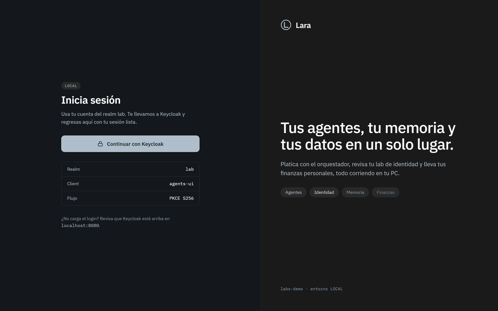

- Izquierda: badge `LOCAL`, título "Inicia sesión", un solo botón **Continuar con Keycloak** (sin campos de usuario/contraseña: el formulario lo muestra Keycloak).
- Debajo: realm, client y flujo en mono. Ayuda si Keycloak no responde.
- Derecha: panel de marca con las 4 áreas (Agentes, Identidad, Memoria, Finanzas).

### 02 · Estado del lab

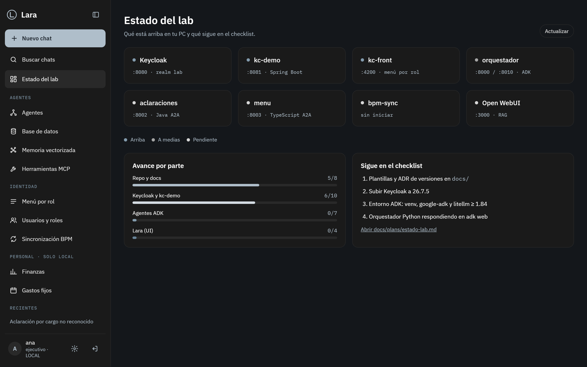

- Grid de 4 columnas con cada servicio: nombre, puerto, punto de estado + leyenda con texto.
- Abajo: "Avance por parte" (barras) y "Sigue en el checklist" (4 siguientes pendientes).

### 03 · Nuevo chat

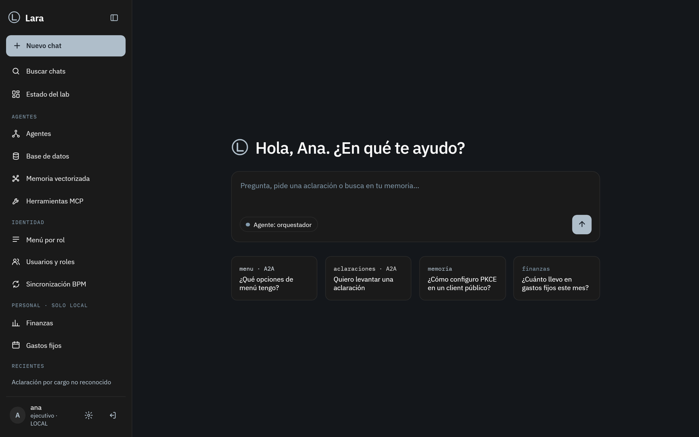

- Saludo con el nombre del usuario, composer grande y 4 sugerencias con la etiqueta del agente o fuente que responde.

### 04 · Chat

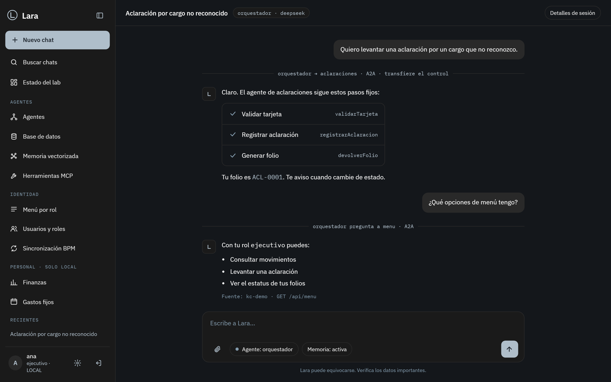

- Encabezado: título de la conversación + agente y modelo.
- Mensajes del usuario a la derecha; respuestas con avatar a la izquierda.
- **Eventos A2A** como separador centrado en mono ("orquestador → calculos-financieros · A2A · transfiere el control").
- Pasos del flujo determinista como lista con check.
- Composer: adjuntar, agente activo, memoria activa, enviar. Streaming: el texto aparece mientras llega.
- La salida del agente se pinta como texto. **Nunca** `dangerouslySetInnerHTML`.

### 05 · Agentes

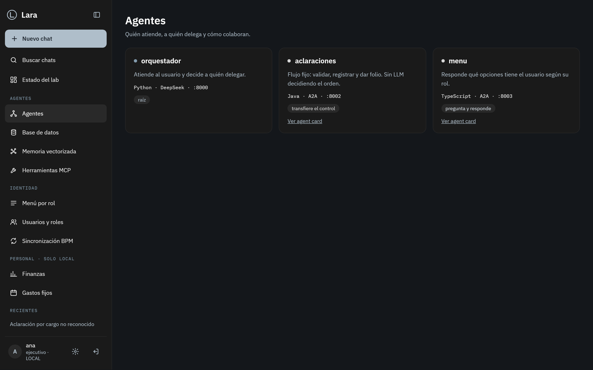

- Una tarjeta por agente: estado, descripción, lenguaje/puerto y una pill con su forma de colaborar (raíz, transfiere el control, pregunta y responde). Link a su agent card.

### 06 · Base de datos

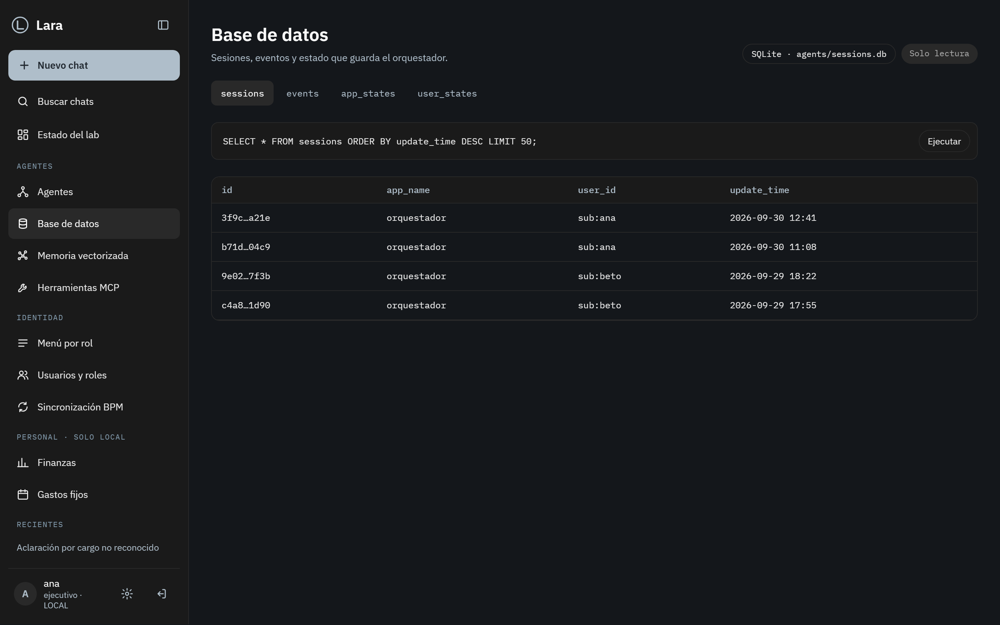

- Pills: motor y archivo, **Solo lectura**. Tabs por tabla. Consulta SQL visible y resultado en tabla mono.
- Solo `SELECT`. La conexión se abre en modo lectura.

### 07 · Memoria vectorizada

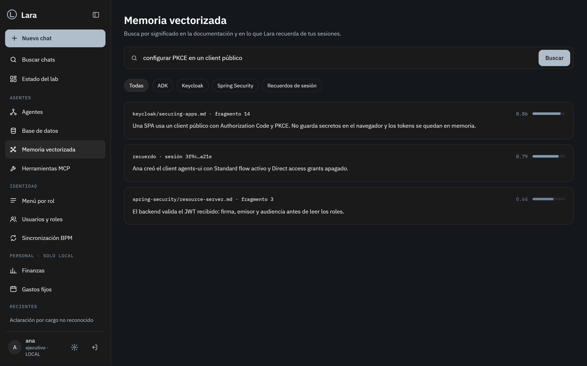

- Buscador, filtros por colección y resultados con fuente, fragmento y puntaje de similitud (barra + número).

### 08 · Herramientas MCP

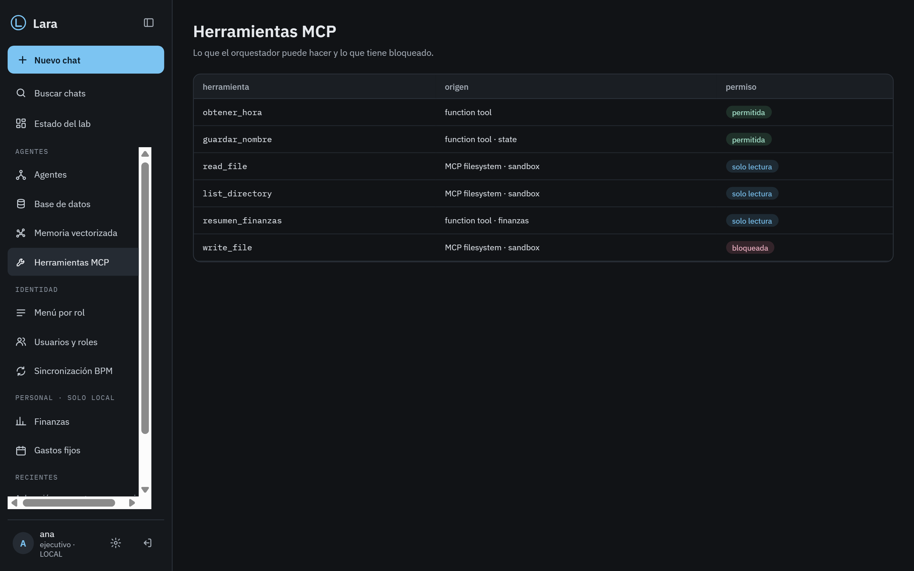

- Tabla: herramienta, origen, permiso (permitida / solo lectura / bloqueada).

### 09 · Menú por rol

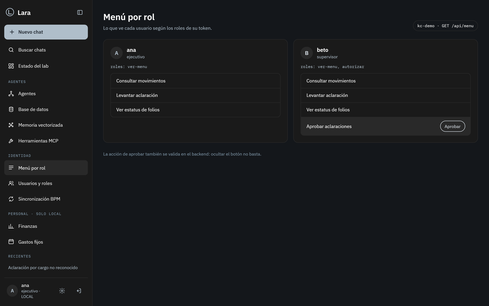

- Una tarjeta por usuario de prueba con sus roles y las opciones que ve. La acción "Aprobar" solo para el rol `autorizar`.
- Nota: la acción también se valida en el backend.

### 10 · Usuarios y roles

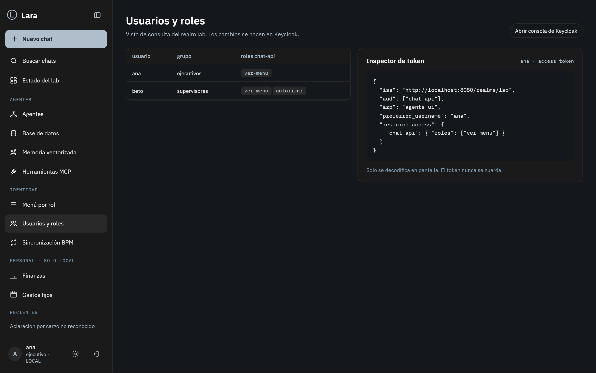

- Tabla de usuarios, grupo y roles del client. Inspector de token con los claims decodificados.
- El token solo se decodifica en pantalla; nunca se guarda ni se manda a otro lado.

### 12 · Finanzas

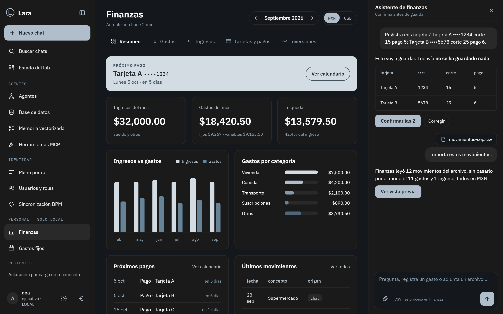

- Encabezado: título y "Actualizado hace N min"; a la derecha, periodo con botones ◀ ▶ ("Mes anterior" / "Mes siguiente"), alternador MXN/USD y botón **Asistente** cuando el panel está cerrado. Contenido con ancho máximo de ~1180px.
- 5 pestañas con ícono: **Resumen · Gastos · Ingresos · Tarjetas y pagos · Inversiones**. La activa lleva texto en 600 y una línea inferior de 2px; se refleja en la URL, por ejemplo `/finanzas/gastos`. **Inversiones** (`/finanzas/inversiones`) tiene un selector MX | USA; las rutas anteriores `/finanzas/trading-mx` y `/finanzas/trading-usa` redirigen ahí.
- Bloque **Próximo pago** destacado arriba de Resumen y de Tarjetas y pagos: alias, ••••, fecha y "en N días", con el botón "Ver calendario".
- Resumen: 3 KPIs (ingresos del mes, gastos del mes, te queda), ingresos vs. gastos de 6 meses, gastos por categoría, próximos pagos y últimos movimientos con su origen (chat, archivo, notificación o manual). Si faltan los totales mensuales se muestra un solo aviso con su historia, no KPIs vacíos.
- Panel derecho **Asistente de finanzas** (~384px), plegable y como drawer en pantallas estrechas. Renderiza Markdown con `react-markdown`, incluidas tablas.
- Para varias transacciones, muestra un preview y una confirmación para el conjunto (**Confirmar las N**). El botón para adjuntar archivos va dentro del composer; finanzas procesa los archivos, nunca se envían al LLM.
- No hay una caja separada de **Importar CSV**. Inversiones (MX y USA) muestra un estado vacío hasta FIN-04.
- Implementado en `lara-web` (UI-09): el subtítulo muestra "Actualizado hace…" (se refresca cada 30 s); "Próximo pago" y "en N días" salen del calendario de los próximos 30 días y de la fecha de hoy (la UI solo resta fechas); "Ver calendario" en Resumen lleva a Tarjetas y pagos. Mientras el servicio no entregue los totales del mes, Resumen muestra un solo aviso en lugar de tres KPIs vacíos.
- Diferencia pendiente: los filtros de la pestaña **Gastos** quedan fuera de esta pasada.

### 13 · Gastos fijos (a futuro)

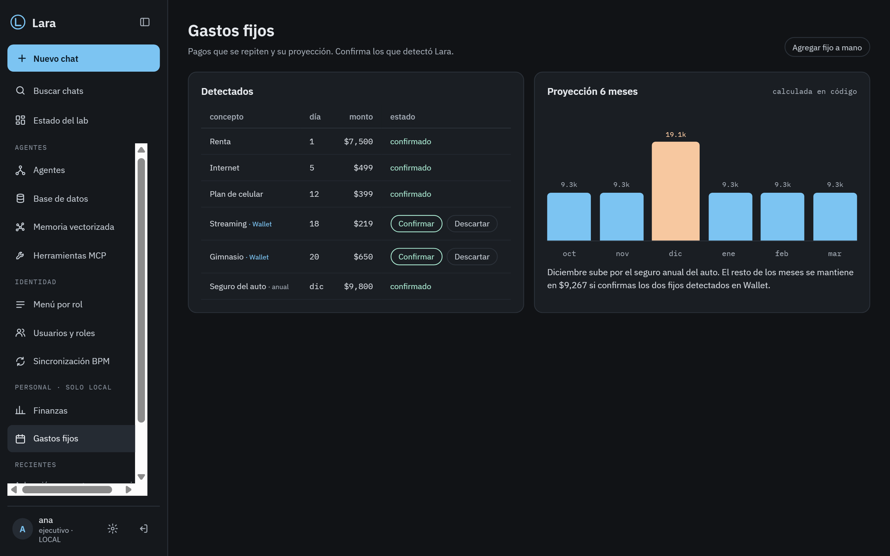

- Tabla de fijos detectados: confirmados y por confirmar (Confirmar / Descartar).
- Proyección de 6 meses en barras; el pico se resalta con `chart-4` (más oscuro que el resto de las barras) y su explicación va en texto; no hay un color extra en los tokens.
- La proyección se calcula en código, no con el LLM.

### 14 · Tarjetas y pagos

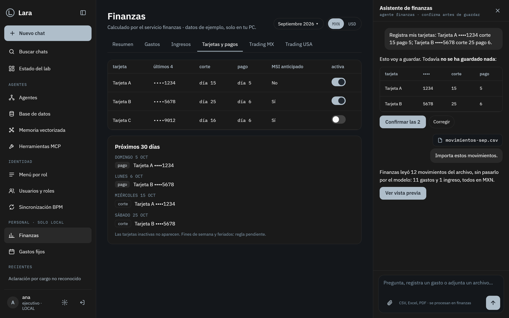

- Bloque **Próximo pago** arriba, igual que en Resumen.
- **Mis tarjetas** como tiles: alias, ••••, día de corte, día de pago, "Pago en N días", MSI y un toggle para activarla o desactivarla. La inactiva va atenuada, con la etiqueta "Inactiva" y "fuera del calendario". Contador "N activas · N inactivas".
- Calendario del mes en cuadrícula de 7 columnas: ● pago, ○ corte. El día es seleccionable y su detalle aparece debajo; se navega con teclado (`role="grid"`). Las tarjetas inactivas no se muestran.
- La entrada lateral anterior `/finanzas/pagos` ahora es esta pestaña.
- Implementado en `lara-web` (UI-09): la tarjeta inactiva se atenúa con tokens (`muted`, `faint`, borde discontinuo) y no con `opacity`, para mantener el contraste AA; el calendario añade flechas de mes y se carga por mes al servicio; teclas: flechas, Inicio/Fin (lunes/domingo), RePág/AvPág (mes). Con 7 columnas, a 320 px cada día mide ~30 px de ancho (cumple el mínimo de 24 px de WCAG 2.5.8, pero no los 44 px de la navegación).

## Reglas para implementar

- Arquitectura hexagonal ligera: `AuthPort`, `AgentePort` y un puerto por fuente de datos de cada vista.
- Tokens solo en memoria. Nada en `localStorage`, con dos excepciones: la clave `lara.fuente` (fuente elegida en "Apariencia") y la clave `lara.tema` (`sistema` | `claro` | `oscuro`, por defecto `sistema`). Son preferencias visuales, no sensibles, y se usan siempre con `try/catch` y valor por defecto. Ningún otro dato puede ir a `localStorage`.
- Datos de relleno: un único composition root (`src/infrastructure/composition.ts`) elige los adaptadores. Con `VITE_USE_MOCKS=true` usa los mock de `src/infrastructure/mocks/` (ficticios, solo en memoria, marcados `// MOCK`) para `AuthPort`, `AgentePort`, `ModeloPort`, `EstadoLabPort`, `MenuPort` y `FinanzasPort`, y Lara abre sin Keycloak ni backend con una pill "MOCK" junto al logo. Sin la variable (o con `false`) usa los servicios reales. Para activarlo copia `apps/lara-web/.env.example` a `.env.local` (ignorado por Git) o, en PowerShell, `$env:VITE_USE_MOCKS = "true"; npm run dev`.
- Vistas de administración (BD, usuarios, herramientas) **solo lectura** desde Lara.
- Finanzas: datos en el servicio finanzas (Postgres local); al LLM solo le llegan resultados calculados.
- Botones reales (`<button>`, `<a>`), `aria-label` en botones de solo ícono, contraste AA.
- Estados comunes de las vistas que cargan datos: carga con esqueletos (`animate-pulse`, quieto con `prefers-reduced-motion`) y un aviso `role="status"` para lectores de pantalla; vacío con una frase en lenguaje claro (nunca claves del backlog ni "Pendiente:"); error con `role="alert"` y botón **Reintentar**.
